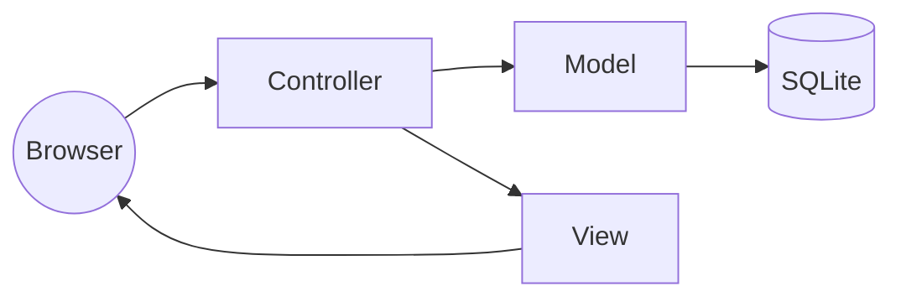
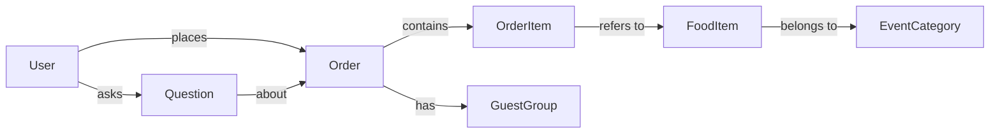
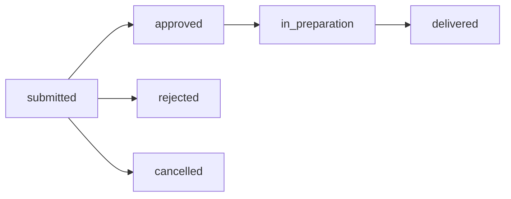

# Ekte Mat Online – Report material (INFO212 Oblig 4)

Content for the final report. Screenshots are in [`docs/screenshots/`](screenshots/),
taken from the seeded demo data.

---

## 1. Front page

| | |
|---|---|
| Course | INFO212, Obligatory Assignment 4 |
| Project | Ekte Mat Online |
| Group members | Heine Moe Larsen, Nicolai Holth, Torfinn Sønsteby, Tobias Bjørneby |
| GitHub repository | https://github.com/HeineML/Ekte-Mat-Assignment-4 |
| Assessed version | tag **`v1.0`** |
| Neo4j used? | **No.** SQLite behind repository interfaces, so Neo4j can replace it later. |

---

## 2. Features

All mandatory functionality is implemented; optional extensions were not.

### Customer

| Feature | Description | Screenshot |
|---|---|---|
| **C1 Menu by event** | Published dishes grouped by event, with picture, price, minimum order, allergens and dietary labels. | [01](screenshots/01-menu.png), [02](screenshots/02-menu-by-event.png) |
| **C2 Shopping cart** | Add, change and remove dishes, with an estimated total. Quantities below the minimum are rejected. | [03](screenshots/03-minimum-quantity-rejected.png), [04](screenshots/04-cart.png) |
| **C3 Register and order** | Register, log in and submit an order with event date, guests, address and guest groups with allergy/dietary notes. | [05](screenshots/05-register.png), [06](screenshots/06-checkout.png) |
| **C4 My orders** | Own orders only, with order and payment status. | [08](screenshots/08-my-orders.png), [07](screenshots/07-order-detail-with-question.png) |
| **C5 Questions** | Ask a question about an order and read the answer. | [07](screenshots/07-order-detail-with-question.png), [16](screenshots/16-customer-sees-status-and-answer.png) |

### Administrator

| Feature | Description | Screenshot |
|---|---|---|
| **Access control** | Admin pages require the admin role; customers get "Access denied". | [09](screenshots/09-access-denied-for-customer.png) |
| **A1 Food items** | Create, edit, delete and publish/unpublish dishes. | [14](screenshots/14-admin-food-list.png) |
| **A2 Images** | Upload a picture with preview before saving; placeholder when missing. | [15](screenshots/15-admin-food-form-image-preview.png) |
| **A3 Orders** | All orders, filtered by status and event date; change order and payment status. | [10](screenshots/10-admin-orders.png), [11](screenshots/11-admin-orders-filtered.png), [12](screenshots/12-admin-order-detail.png) |
| **A4 Questions** | See questions with their order and answer them. | [13](screenshots/13-admin-questions.png) |

---

## 3. Software design

### 3.1 Architecture (MVC)

- **Model:** entities and status enums, abstract repositories, and a service layer with the domain rules
  (minimum quantity, checkout validation, price snapshot). Only `sqlite/` knows SQL.
- **Controller:** one Flask blueprint per area; access control via `login_required` and `admin_required`.
- **View:** Jinja2 templates with shared macros.

**Neo4j readiness:** controllers get data only through `get_repos()`, and repositories return entities, never
database rows. A Neo4j backend would add `app/models/neo4j/` and change one config value. The repository
tests use only the interface, and `tests/test_architecture.py` fails if a controller or template mentions SQLite.

### 3.2 Domain model

- **GuestGroup** holds allergy and dietary notes per guest group, as C3 asks.
- **OrderItem** copies the dish name and price, so old orders don't change when a dish is edited.
- The cart is not an entity; it lives in the session until checkout.

### 3.3 Order status

Payment status: `not_paid` → `deposit_paid` → `invoiced` → `paid`. Both are enums, and only admins change them.

### 3.4 Main design decisions

| Decision | Reason |
|---|---|
| SQLite behind repository interfaces | Keeps Neo4j possible later. |
| Service layer for domain rules | Thin controllers; rules tested without HTTP. |
| Cart in the session | Customers can fill a cart before logging in. |
| 404 for other customers' orders | Customers only see their own data. |
| Admins only from seed data | Registration can never create an admin. |
| Upload instead of AI images | Allowed by A2; no API keys needed. |

**Testing:** 162 pytest tests cover the repositories, every feature, access control and validation.

---

## 4. Reflection

Our prior knowledge of software design helped us organize the main functionality of the application and gave
us a clear overview of how the system should work. It also guided us when using Claude Code: with the
requirements and architecture rules written down, the generated code stayed consistent across features.
Phases 0–4 were agreed before implementation, while phases 5–12 were implemented first and reviewed by the
group afterwards. That was faster, but gave us less control over small design decisions.