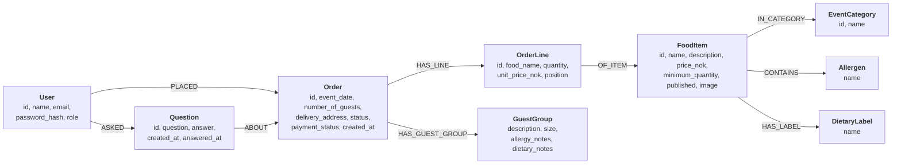

# Ekte Mat Online on Neo4j – Report (INFO212 Oblig 5)

## 1. Front page

| | |
|---|---|
| Course | INFO212, Obligatory Assignment 5 |
| Group members | Heine Moe Larsen, Nicolai Holth, Torfinn Sønsteby, Tobias Bjørneby |
| GitHub repository | https://github.com/HeineML/Ekte-Mat-Assignment-4 |
| Assessed version | tag **`oblig5`** |
| Neo4j setup | **Neo4j Aura** (AuraDB Free) |

---

## 2. Graph data model

### Design choices

- **Allergens and dietary labels are nodes.** All dishes with milk share one `Allergen {name: "milk"}` node, so
  the menu filter (dishes without chosen allergens and with chosen dietary labels) follows `CONTAINS` and
  `HAS_LABEL` instead of searching text.
- **Event categories are nodes,** because a dish belongs to several events (`IN_CATEGORY`).
- **An order line is its own node with a copied name and price.** Old orders must not change when a dish is
  edited or deleted: deleting a dish only removes `OF_ITEM`, and the line keeps its name and price.
- **Who placed an order or asked a question is a relationship** (`PLACED`, `ASKED`, `ABOUT`). "Customers only see
  their own orders" becomes a path match from the user to the order.
- **Order and payment status are properties, not nodes.** An order has exactly one of each, and they are always
  read with the order.

### Differences from the Oblig 4 domain class diagram

- **Allergens and dietary labels** were text attributes on `FoodItem`; now they are shared nodes.
- **Associations are stored as relationships,** so the foreign keys (`customer_id`, `order_id`, `food_item_id`)
  and the join table between food items and categories are gone from the stored data.
- **`OrderItem` is stored as an `OrderLine` node.**
