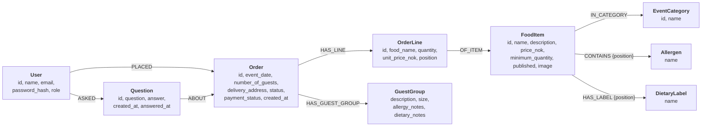

# Ekte Mat Online on Neo4j – Report (INFO212 Oblig 5)

Draft for the final PDF (about 2–3 pages). The Oblig 4 report material is in [report.md](report.md).

---

## 1. Front page

| | |
|---|---|
| Course | INFO212, Obligatory Assignment 5 |
| Project | Ekte Mat Online on Neo4j |
| Group members | Heine Moe Larsen, Nicolai Holth, Torfinn Sønsteby, Tobias Bjørneby |
| GitHub repository | https://github.com/HeineML/Ekte-Mat-Assignment-4 |
| Assessed version | tag **`oblig5`** |
| Neo4j setup | **Neo4j Aura** (AuraDB Free), with the official `neo4j` Python driver. |

How to run it is in the README: copy `.env.example` to `.env`, fill in the Aura connection, then
`flask --app app seed` and `flask --app app run`.

---

## 2. What changed

The application keeps all Oblig 4 functionality, but every piece of data is now stored in and read from Neo4j:
food items with image references, event categories, allergens and dietary labels, users, orders with order lines,
guest groups, order and payment status, and questions with answers.

- **Only repositories talk to Neo4j.** The Cypher is in `app/models/neo4j/repositories.py`, and the driver is
  created in `app/models/neo4j/db.py`. Controllers and templates did not need to change for the switch, because
  they only use `get_repos()` and the entity classes. A test (`tests/test_architecture.py`) fails if a controller
  or template contains Cypher or imports the driver.
- **Parameterised Cypher and transactions.** All values are passed as `$parameters`. Each repository method runs
  as one managed transaction, so submitting an order with its lines and guest groups, or saving a food item with
  its categories, allergens and labels, is stored completely or not at all.
- **SQLite is separated and unused.** The Oblig 4 SQLite code is moved to `legacy/sqlite/` for reference.
  Nothing in the application imports it.
- **One new feature that uses the graph:** the menu can be filtered to dishes *without* chosen allergens and
  *with* chosen dietary labels (C1).

---

## 3. Graph data model

> Add a screenshot of the graph from the Aura console here (`MATCH (n) RETURN n LIMIT 300` after `seed`).



Constraints: unique `id` on the nodes the app looks up by id, unique `User.email`, and unique `name` on
`EventCategory`, `Allergen` and `DietaryLabel`.

### Design choices

| Choice | Why |
|---|---|
| **Allergens and dietary labels are nodes** | All dishes with milk share one `Allergen {name: "milk"}` node. The menu filter follows `CONTAINS` and `HAS_LABEL` instead of searching text, and questions like "which dishes contain nuts?" become one short pattern. |
| **Event categories are nodes** | A dish belongs to several events. The relationship `IN_CATEGORY` replaces the join table from SQLite. |
| **An order line is its own node with a copied name and price** | Old orders must not change when a dish is edited or deleted. `OF_ITEM` points to the current dish; deleting the dish only removes that relationship, and the line keeps its name and price. |
| **Who placed an order or asked a question is a relationship** | `PLACED`, `ASKED` and `ABOUT` replace the foreign keys. "Only your own orders" is a path match: `(:User {id: $customer})-[:PLACED]->(:Order {id: $order})`. |
| **Order and payment status are properties, not nodes** | An order has exactly one of each, they are always read with the order, and admins filter on them as values. Nodes would add relationships without making any query simpler. |
| **Integer ids from a counter node** | Neo4j's own `elementId` is a string that can be reused after deletion. A `(:Counter {name})` node per label gives whole-number ids in the same transaction that creates the node, so URLs like `/orders/7` and the shopping cart work unchanged. |
| **`position` keeps the order of lists** | Graph relationships have no order. The position on `CONTAINS`, `HAS_LABEL`, order lines and guest groups returns them in the order they were entered. |

### Queries that use the graph

The menu filter (C1) walks from each published dish to its allergens and labels:

```cypher
MATCH (f:FoodItem {published: true})
WHERE ($category_id IS NULL OR EXISTS { (f)-[:IN_CATEGORY]->(:EventCategory {id: $category_id}) })
  AND NOT EXISTS { (f)-[:CONTAINS]->(a:Allergen) WHERE a.name IN $exclude_allergens }
  AND all(label IN $require_labels WHERE EXISTS { (f)-[:HAS_LABEL]->(:DietaryLabel {name: label}) })
```

Reading an order follows `PLACED`, `HAS_LINE`, `OF_ITEM` and `HAS_GUEST_GROUP` in one query, and the list of
allergens to choose from is every `Allergen` reached by `CONTAINS` from a published dish.

---

## 4. Compared with the Oblig 4 domain class diagram

The domain classes in the application (`app/models/entities.py`) did not change; the repositories translate
between them and the graph. The difference is in how the data is stored:

- **Lists of text became nodes.** In Oblig 4, `allergens` and `dietary_labels` were attributes on `FoodItem`
  (stored as JSON text in SQLite). In the graph they are the nodes `Allergen` and `DietaryLabel`, shared by all
  dishes.
- **Associations became named relationships.** The associations in the class diagram (*places*, *contains*,
  *has*, *asks*, *about*, *refers to*, *belongs to*) are now stored directly as relationships, so the foreign key
  attributes `customer_id`, `order_id` and `food_item_id` and the join table `food_item_categories` are gone
  from the stored data.
- **`OrderItem` is stored as an `OrderLine` node**, matching the assignment's "order lines". It still copies the
  name and price, as in Oblig 4.
- **Technical additions:** the `position` property for ordering and the `Counter` nodes for ids. They are not
  part of the domain and don't appear in the class diagram.

---

## 5. Testing

The 170 pytest tests run against a separate Neo4j instance that is emptied before every test, both on Aura and
on a local Neo4j 5 in Docker. The repository tests are the same as in Oblig 4 (written against the interface),
plus new tests for the menu filter.
