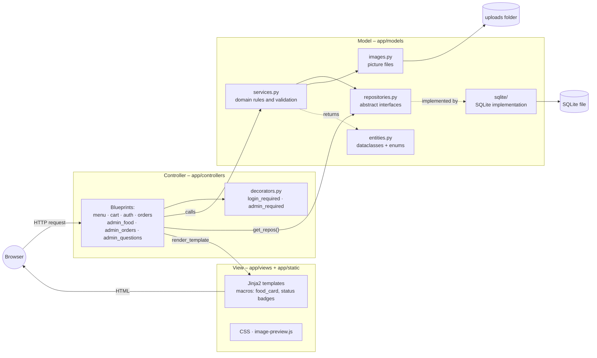
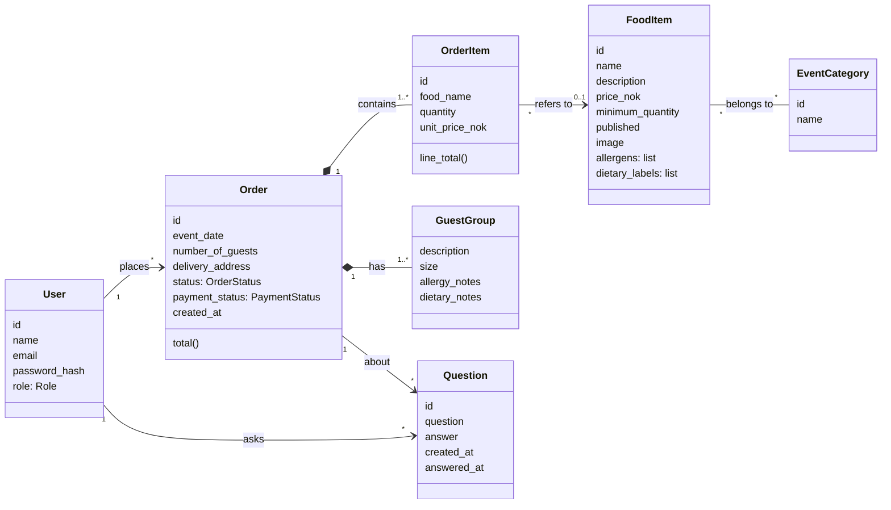
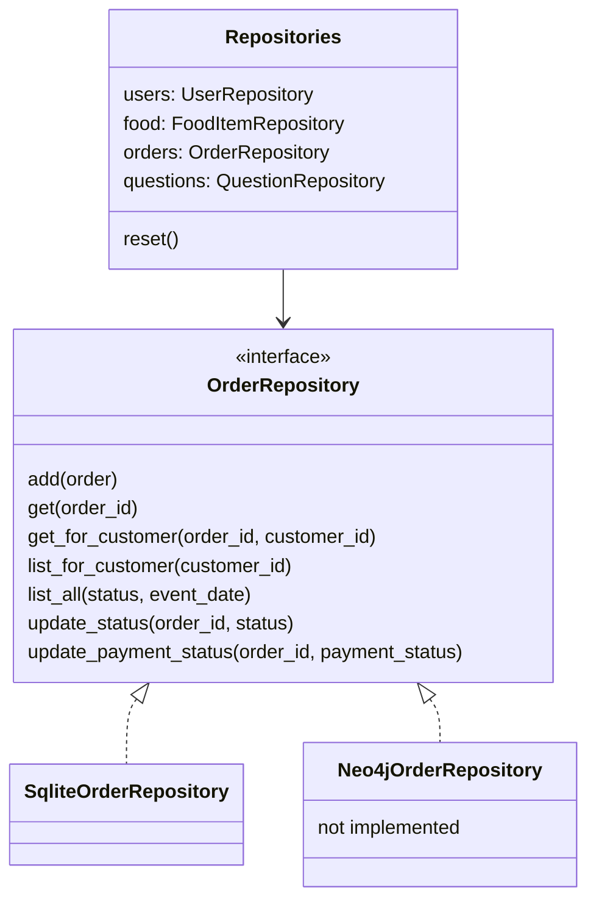
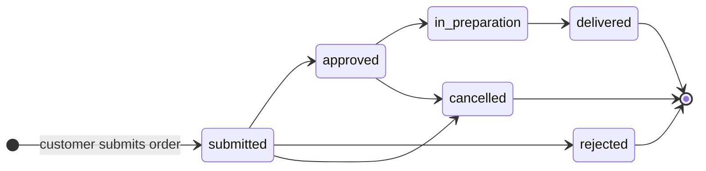
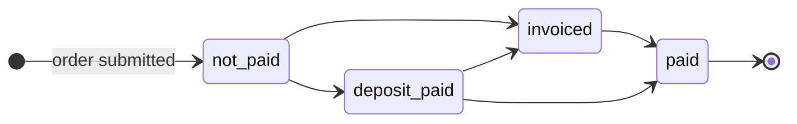
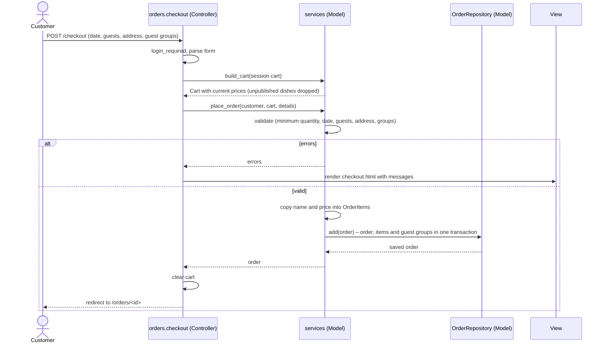

# Ekte Mat Online – Report material (INFO212 Oblig 4)

This file collects the content for the final report (`docs/requirements.md` §11). Screenshots are in
[`docs/screenshots/`](screenshots/) and were taken from the seeded demo data (`flask --app app seed`).
Diagrams use Mermaid, which GitHub renders directly.

---

## 1. Front page

| | |
|---|---|
| Course | INFO212, Obligatory Assignment 4 |
| Project | Ekte Mat Online |
| Group members | Heine Moe Larsen, *(add the other group members)* |
| GitHub repository | https://github.com/HeineML/Ekte-Mat-Assignment-4 |
| Assessed version | tag **`v1.0`** |
| Neo4j used? | **No.** Storage is SQLite behind repository interfaces, so Neo4j can replace it later (see §3.3). |

---

## 2. Features

All mandatory functionality in `docs/requirements.md` §6 is implemented. Optional extensions (§7) were not
implemented, by the group's decision. The table in [`plans/12-hardening.md`](plans/12-hardening.md) maps
every requirement to its routes, plan and tests.

### Customer

| Feature | Description | Screenshot |
|---|---|---|
| **C1 Menu by event** | Published dishes grouped by event category, with a tab per event. Each card shows picture, name, description, price in NOK, minimum order, allergens and dietary labels. Unpublished dishes are never shown. | [01-menu](screenshots/01-menu.png), [02-menu-by-event](screenshots/02-menu-by-event.png) |
| **C2 Shopping cart** | Add dishes, change quantities, remove lines and see an estimated total. Quantities below a dish's minimum are rejected with a message. | [03-minimum-quantity-rejected](screenshots/03-minimum-quantity-rejected.png), [04-cart](screenshots/04-cart.png) |
| **C3 Register, log in and order** | Customers register and log in (passwords are hashed). Checkout asks for event date, number of guests, delivery address and guest groups with allergy and dietary notes. No online payment. | [05-register](screenshots/05-register.png), [06-checkout](screenshots/06-checkout.png) |
| **C4 My orders** | A customer sees only their own orders, each with order status and payment status, and can open the details. Other customers' orders give "Page not found". | [08-my-orders](screenshots/08-my-orders.png), [07-order-detail-with-question](screenshots/07-order-detail-with-question.png) |
| **C5 Questions** | On their order page a customer asks a question and later reads the administrator's answer. | [07-order-detail-with-question](screenshots/07-order-detail-with-question.png), [16-customer-sees-status-and-answer](screenshots/16-customer-sees-status-and-answer.png) |

### Administrator

| Feature | Description | Screenshot |
|---|---|---|
| **Admin login and access control** | Admins log in on the same page and get an admin menu. Customers get "Access denied" on admin pages. Admin accounts come only from the seed data. | [10-admin-orders](screenshots/10-admin-orders.png), [09-access-denied-for-customer](screenshots/09-access-denied-for-customer.png) |
| **A1 Food items** | Create, edit, delete and publish/unpublish dishes with name, description, price, minimum quantity, event categories, allergens and dietary labels. | [14-admin-food-list](screenshots/14-admin-food-list.png), [15-admin-food-form-image-preview](screenshots/15-admin-food-form-image-preview.png) |
| **A2 Images** | Upload a picture for a dish; the browser previews it before saving. Dishes without a picture show a placeholder. The demo dishes use freely licensed photos (credits at `/photo-credits`). | [15-admin-food-form-image-preview](screenshots/15-admin-food-form-image-preview.png) |
| **A3 Orders** | All orders, filtered by status and/or event date. The order page shows customer, dishes, guest groups and notes, and lets the admin change order status and payment status. | [10-admin-orders](screenshots/10-admin-orders.png), [11-admin-orders-filtered](screenshots/11-admin-orders-filtered.png), [12-admin-order-detail](screenshots/12-admin-order-detail.png) |
| **A4 Questions** | All or unanswered questions, each with a link to its order and the customer's name. The admin writes (or corrects) an answer, which the customer then sees. | [13-admin-questions](screenshots/13-admin-questions.png), [16-customer-sees-status-and-answer](screenshots/16-customer-sees-status-and-answer.png) |

---

## 3. Software design

### 3.1 Architecture (MVC)

The application is a Flask app built with an application factory (`create_app()` in `app/__init__.py`).
It follows MVC, with the Model split into a service layer (domain rules) and a repository layer (storage).

- **Model** (`app/models/`): `entities.py` holds the domain classes and the status enums with no storage
  code. `repositories.py` defines abstract repository interfaces, and `sqlite/` is the only code that knows
  SQL. `services.py` contains the domain rules (minimum quantity, checkout validation, price snapshot,
  registration, food item validation, questions); each function returns `(result, [error messages])`.
  `images.py` stores uploaded pictures, and `seed.py` provides the `init-db` and `seed` commands.
- **Controller** (`app/controllers/`): one blueprint per area. Controllers read the request, call services
  or repositories, flash messages and choose a template. Access control is done with the
  `login_required` and `admin_required` decorators.
- **View** (`app/views/`, configured with `template_folder="views"`): Jinja2 templates extending
  `base.html`, with shared macros for the food card, status badges, order contents and admin questions.
  JavaScript is only used for the image preview and the delete confirmation.

### 3.2 Domain model

Compared with the suggested model in `docs/requirements.md` §5:
- **EventCategory** is a separate entity, so a dish can belong to several events and the menu can be grouped.
- **GuestGroup** replaces the single `allergy_notes`/`dietary_notes` fields on Order, because C3 asks for
  notes *per guest group* (group decision, 2026-10-28).
- **OrderItem** stores `food_name` and `unit_price_nok` when the order is placed, so editing or deleting a
  dish never changes old orders. If a dish is deleted, `food_item_id` becomes empty but the line remains.
- Passwords are stored only as `password_hash`.
- The shopping cart is not an entity: it lives in the session as `{food_item_id: quantity}` until checkout.

### 3.3 Storage and Neo4j readiness

The same pattern applies to users, food items and questions. Controllers and templates get data only
through `get_repos()`, repositories return entity dataclasses (never database rows), and multi-step writes
such as an order with its items and guest groups happen inside one repository method. A Neo4j backend
would add `app/models/neo4j/` and change one config value (`STORAGE`). Two tests guard this:
`tests/test_repositories.py` tests only the interface (so it can be run against a Neo4j implementation),
and `tests/test_architecture.py` fails if a controller or template mentions SQLite.

### 3.4 Order and payment status

Both are enums (`OrderStatus`, `PaymentStatus`) and only enum values can be stored. The diagrams show the
normal flow from A3. The administrator may choose any status from the dropdown, so mistakes can be
corrected; the transitions are not enforced by the code (group decision in plan 09). Only administrators can
change statuses; customers see them on their order pages.

### 3.5 Checkout (C3)

### 3.6 Main design decisions

| Decision | Reason |
|---|---|
| SQLite behind repository interfaces | Allowed by §2; makes filtering and multi-table writes easy, and keeps Neo4j possible later. |
| Service layer for domain rules | Controllers stay thin and the rules are tested without HTTP. |
| Cart in the session | Customers can browse and fill a cart before logging in; the cart survives login. |
| Price and name copied onto order items | Required by §5: old orders don't change when a dish changes. |
| Guest groups as a list on Order | C3 asks for allergy and dietary notes per guest group. |
| 404 for other customers' orders | Customers can't even tell which order numbers exist (§8). |
| Admins only from seed data | Public registration can never create an admin (§8). |
| Session cleared on login, local redirects only | Prevents session fixation and open redirects. |
| Pictures under random filenames, type and size checked | Uploaded filenames are never trusted; old files are deleted when replaced. |
| Upload instead of AI image service | Allowed by A2 for the first version; no API keys needed. |
| Any status change allowed for admins | The requirements describe the normal flow but don't require enforcing it; lets admins correct mistakes. |

Other small rules agreed by the group (see plans 05–11): passwords of at least 8 characters, event date
after today, guest group sizes not above the number of guests, at least one event category per dish,
questions and answers up to 2000 characters, pictures up to 5 MB.

### 3.7 Testing

162 automated pytest tests cover the repository interface, every customer and admin feature, access
control, validation, images, the seed command and the architecture rule. Each test gets a fresh SQLite
database and upload folder. In addition, the complete customer and admin flows were run against a seeded
development server in a real browser to produce the screenshots in this report.

---

## 4. Reflection (draft – the group should edit this into its own words)

Working from a written design helped both the product and the way we steered Claude Code. Because
`docs/requirements.md` was the source of truth and `CLAUDE.md` stated the architecture rules (MVC
boundaries, repositories that return entities, no SQL in controllers, enums for statuses), the generated
code stayed consistent across phases: each new feature reused the same services, decorators and template
macros instead of inventing new patterns. Splitting the work into numbered phases with a plan per phase
in `docs/plans/` gave us traceability from each requirement ID to code, commits and tests, and the tests
made it safe to keep building on earlier phases. Phases 0–4 followed the intended process of planning in
Plan mode and agreeing before implementation. Phases 5–12 were planned and implemented by Claude Code in
one session, one plan and commit per phase, and the group reviewed and agreed to them afterwards. That
was faster, but it meant that small design decisions (marked **[Decision]** in the plans) were made by the
tool first and checked by us later, which is a weaker form of control than agreeing on them in advance.
